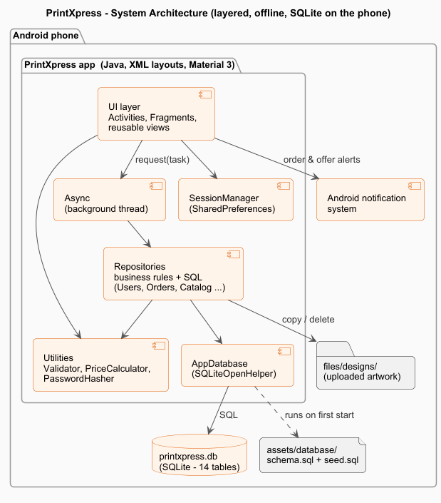
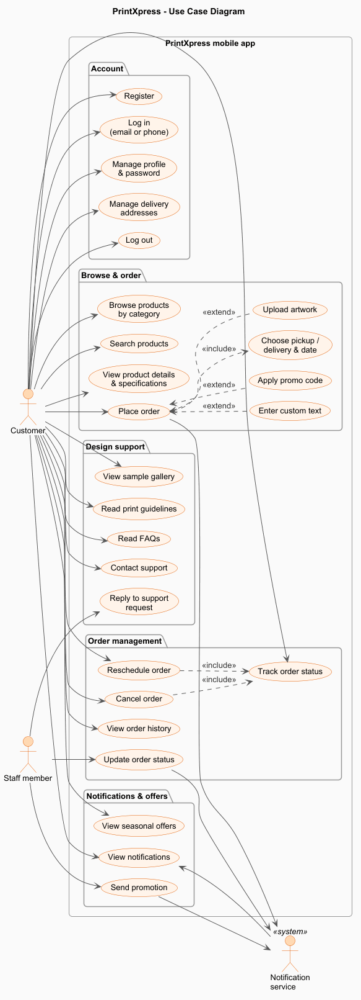
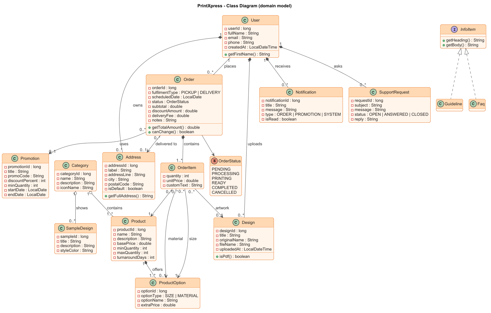
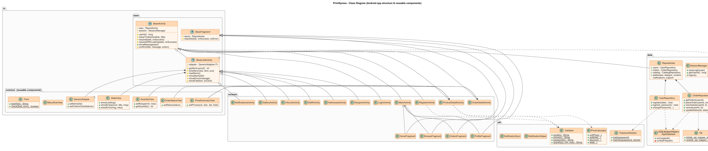
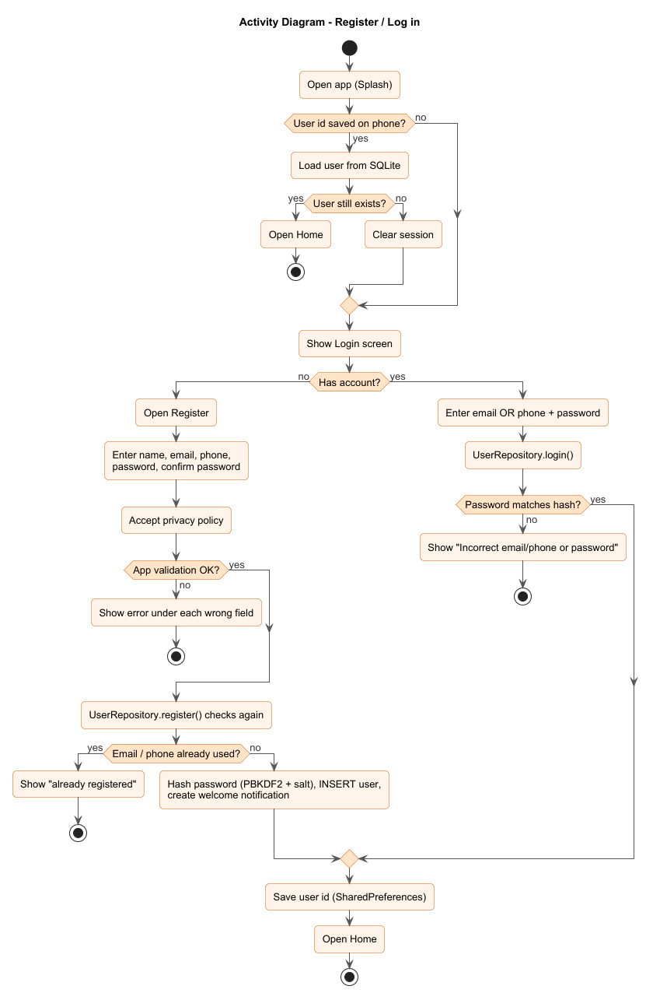
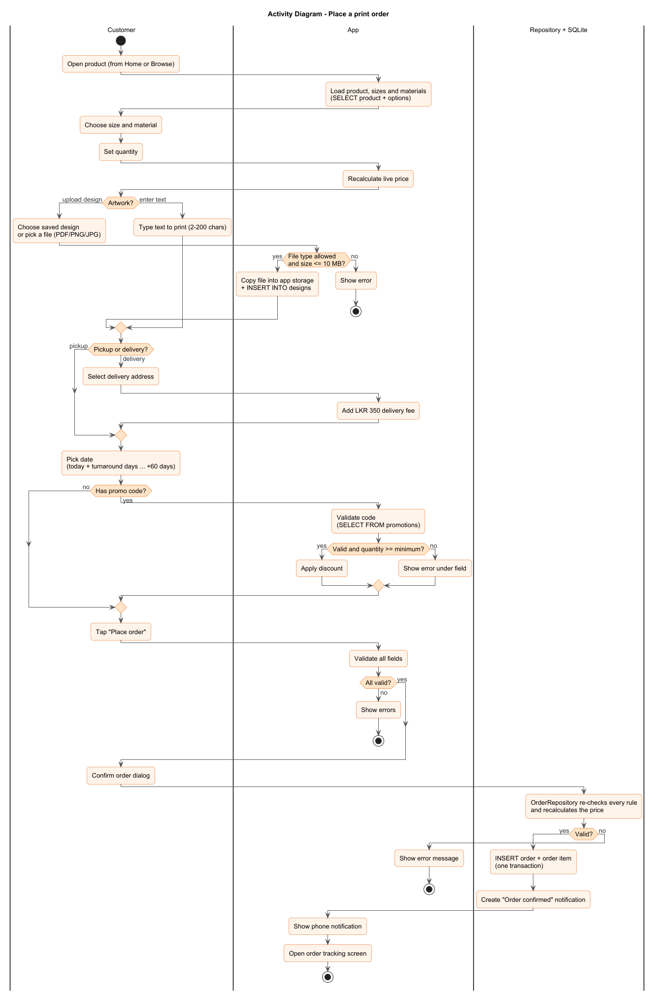
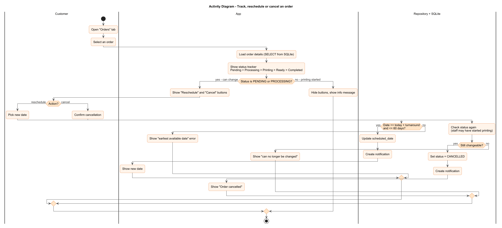
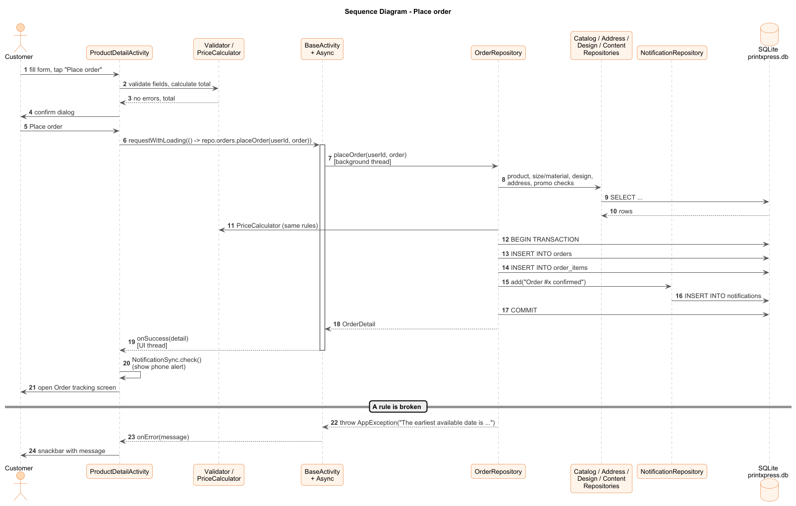
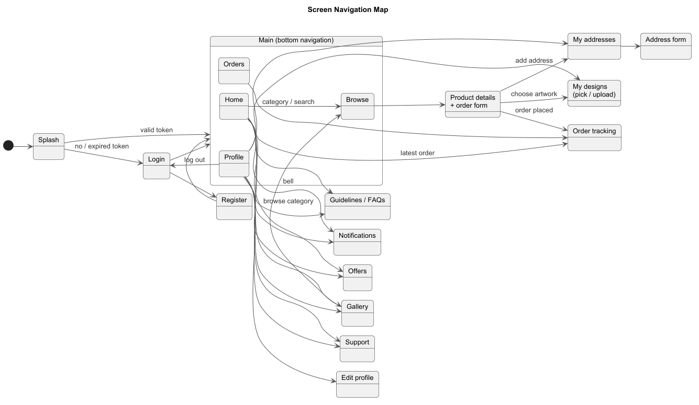

# 2. System Design (Task B)

All diagrams are in [`diagrams/`](diagrams/) as PNG (ready for the report) and PlantUML source
(`.puml`, editable). To re-render after editing: open the `.puml` in VS Code with the *PlantUML*
extension, or run `java -jar plantuml.jar -tpng *.puml` inside `docs/diagrams`.

## 2.1 Architecture

A **single native Android app** with a **local SQLite database**, organised in layers:

| Layer | Classes | Job |
|---|---|---|
| UI | Activities, Fragments, `ui/common` views | Show data, read input, first validation (instant red errors) |
| Async | `Async`, `BaseActivity.request(...)` | Run database work on a background thread so the screen never freezes |
| Repositories | `UserRepository`, `OrderRepository`, `CatalogRepository` … | Business rules + SQL. Re-check every rule, throw `AppException` with a friendly message |
| Database | `AppDatabase` (SQLiteOpenHelper), `Db` helpers | Create tables from `assets/database/schema.sql`, load `seed.sql`, run queries |

| Decision | Why |
|---|---|
| Native Android in **Java** | The brief requires native; Java is taught in the module and works directly with the Android SDK. |
| **SQLite** on the phone | Built into Android — no server, no XAMPP, no internet needed. The app works offline and is easy to install and demonstrate. Relational, so it supports the normalised design, foreign keys and transactions. |
| **SQLiteOpenHelper + plain SQL** (not Room) | Students can read exactly which SQL runs; the same `schema.sql` file is both the documentation and what the app executes. |
| Repository pattern | Screens never write SQL; all rules are in one place and can be tested (`RepositoryTest`). |
| Background thread (`Async`) | Android requires slow work (disk, database, file copy) off the UI thread. |
| PBKDF2 password hashing | Passwords are never stored in plain text, even on the phone. |

**Trade-off (discuss in the report):** data lives on one phone, so staff cannot see customers' orders
from another device. In a real deployment, the repositories would talk to an online API/database
instead — the screens would not need to change, because they only call repositories. For the
assessment, a **Staff demo panel** inside the app plays the staff role (update order status, send
offers, reply to support).

## 2.2 Use case diagram

- **«include»** — *Place order* always includes *Choose pickup/delivery & date*; *Reschedule* and
  *Cancel* include *Track order status*.
- **«extend»** — *Upload artwork*, *Enter custom text* and *Apply promo code* are optional additions
  to *Place order*.
- The *Staff member* use cases are available through the Staff demo panel.

## 2.3 Class diagrams

**Domain model** — the data the system works with:

- Composition (filled diamond): an address, design or notification cannot exist without its user;
  an order item cannot exist without its order.
- `InfoItem` interface: `Guideline` and `Faq` both have a heading and body, so one screen shows both
  (polymorphism).

**App structure** — how the code is organised and reused:

| Reusable piece | Used by | Saves |
|---|---|---|
| `BaseActivity` | every screen | toolbar, insets, background work, loading dialog, messages |
| `BaseListActivity<T>` | Addresses, Designs, Notifications, Offers, Gallery, Guidelines/FAQs, Staff panel | whole list screen (refresh, empty/error states, FAB) |
| `GenericAdapter<T>` | every list | one adapter instead of ~12 |
| `Async` + `AppException` | every database call | threading and friendly error messages |
| `Db` (list / one / number) | every repository | cursor boilerplate |
| `StateView`, `QuantityView`, `PriceSummaryView`, `OrderStatusView`, `MenuRowView` | many screens | consistent UI widgets |
| `Validator`, `PriceCalculator`, `PasswordHasher`, `Form` | forms + repositories | same rules everywhere, unit-tested |

## 2.4 Activity diagrams

| Diagram | Shows |
|---|---|
|  | Splash → saved session check → login / register |
|  | Full order flow with all validation branches |
|  | Track / reschedule / cancel and the "before printing" rule |

## 2.5 Sequence diagram

Shows the layers in action: the screen validates, `Async` moves the work to a background thread,
`OrderRepository` checks the business rules and saves the order and its item inside **one
transaction**, then the result comes back to the UI thread.

## 2.6 Screen flow

## 2.7 Repository summary (what the screens can ask for)

| Repository | Main methods |
|---|---|
| `UserRepository` | `register`, `login` (email or phone), `getUser`, `updateProfile`, `changePassword` |
| `AddressRepository` | `getAddresses`, `save` (add / edit, one default), `delete` |
| `CatalogRepository` | `getCategories`, `getProducts(categoryId, search)`, `getProductDetail`, `getOption` |
| `DesignRepository` | `getDesigns`, `upload` (copy PDF/PNG/JPG ≤ 10 MB into app storage), `delete` |
| `OrderRepository` | `getOrders`, `getOrder`, `placeOrder`, `reschedule`, `cancel`, `updateStatus` (staff), `getAllOrders` (staff) |
| `NotificationRepository` | `getNotifications`, `countUnread`, `markRead`, `markAllRead`, `add`, `addForAllUsers` |
| `ContentRepository` | `getActivePromotions`, `validatePromoCode`, `getGallery`, `getGuidelines`, `getFaqs` |
| `SupportRepository` | `getRequests`, `send`, `getOpenRequests` (staff), `reply` (staff) |

Every method that breaks a rule throws `AppException("friendly message")`, which the screen shows
in a snackbar.
