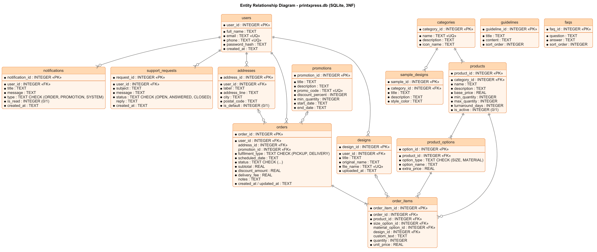

# 3. Database Design (Task B)

**Engine:** SQLite (built into Android). The database file `printxpress.db` lives in the app's
private storage on the phone.

**Scripts:** [`app/src/main/assets/database/schema.sql`](../app/src/main/assets/database/schema.sql)
(14 tables) and [`seed.sql`](../app/src/main/assets/database/seed.sql) (sample data: 7 categories,
14 products, 62 options, 4 offers, guidelines, FAQs, gallery). `AppDatabase.java` runs both the
first time the app starts and adds the demo customer (its password must be hashed in Java).

## 3.1 ER diagram



Crow's-foot notation: `||` exactly one, `o|` zero or one, `|{` one or many, `o{` zero or many.

## 3.2 Normalisation

### Starting point — one un-normalised "order form" (UNF)

```
ORDER( order_no, customer_name, customer_email, customer_phone, address,
       { product, category, size, size_extra, paper, paper_extra, qty, price, artwork_file },
       promo_code, promo_percent, delivery_type, date, status, total )
```

Problems: repeating group of products, the same customer details typed on every order, product
prices copied everywhere (update anomalies), deleting the last order of a promotion loses the
promotion (delete anomaly).

### 1NF — atomic values, no repeating groups
The product group moves to its own rows: **ORDER** and **ORDER_ITEM** (key `order_item_id`, FK
`order_id`). Address split into `address_line`, `city`, `postal_code`.

### 2NF — no partial dependencies
Every table now has a single-column surrogate key (`*_id`), so no attribute can depend on only part
of a key. Customer details (`full_name`, `email`, `phone`) depend on the customer, not on the order
→ moved to **USERS**. Product details depend on the product → **PRODUCTS**.

### 3NF — no transitive dependencies
| Transitive dependency found | Fix |
|---|---|
| `order → product → category name` | **CATEGORIES** table, products keep only `category_id` |
| `order_item → size name → size extra price` | **PRODUCT_OPTIONS** (`option_type` SIZE / MATERIAL) |
| `order → promo_code → discount_percent` | **PROMOTIONS**, orders keep only `promotion_id` |
| `order → address → city, postal_code` | **ADDRESSES** owned by the user |
| `order → total` (total = subtotal − discount + delivery) | `total` is **not stored**; it is calculated in SQL / `OrderDetail.getTotalAmount()` |
| `order_item → artwork file → upload date` | **DESIGNS** table |

**Deliberate snapshot fields (justified):** `order_items.unit_price`, `orders.subtotal`,
`discount_amount`, `delivery_fee` record the price *at the time of ordering*. They are historical
facts, not copies — if a product price changes next month, old orders must not change.

## 3.3 Relational schema (3NF)

<u>underline</u> = primary key, *italic* = foreign key

- **users** (<u>user_id</u>, full_name, email UQ, phone UQ, password_hash, created_at)
- **addresses** (<u>address_id</u>, *user_id*, label, address_line, city, postal_code, is_default)
- **categories** (<u>category_id</u>, name UQ, description, icon_name)
- **products** (<u>product_id</u>, *category_id*, name, description, base_price, min_quantity, max_quantity, turnaround_days, is_active)
- **product_options** (<u>option_id</u>, *product_id*, option_type, option_name, extra_price)
- **designs** (<u>design_id</u>, *user_id*, title, original_name, file_name UQ, uploaded_at)
- **promotions** (<u>promotion_id</u>, title, description, promo_code UQ, discount_percent, min_quantity, start_date, end_date)
- **orders** (<u>order_id</u>, *user_id*, *address_id*, *promotion_id*, fulfilment_type, scheduled_date, status, subtotal, discount_amount, delivery_fee, notes, created_at, updated_at)
- **order_items** (<u>order_item_id</u>, *order_id*, *product_id*, *size_option_id*, *material_option_id*, *design_id*, custom_text, quantity, unit_price)
- **notifications** (<u>notification_id</u>, *user_id*, title, message, type, is_read, created_at)
- **support_requests** (<u>request_id</u>, *user_id*, subject, message, status, reply, created_at)
- **sample_designs** (<u>sample_id</u>, *category_id*, title, description, style_color)
- **guidelines** (<u>guideline_id</u>, title, content, sort_order)
- **faqs** (<u>faq_id</u>, question, answer, sort_order)

## 3.4 SQLite design decisions

| Decision | Reason |
|---|---|
| `INTEGER PRIMARY KEY AUTOINCREMENT` | Simple, stable surrogate keys; email/phone can change. |
| `UNIQUE` on email, phone, promo_code, file_name | The database itself blocks duplicates (second line of defence after the app). |
| `CHECK (... IN (...))` for status / type columns | SQLite has no ENUM; CHECK allows only valid values (tested: `'BOAT'` is rejected). |
| Booleans as `INTEGER` 0/1 with CHECK | SQLite has no BOOLEAN type. |
| Dates as `TEXT 'YYYY-MM-DD'` | SQLite has no DATE type; this format sorts and compares correctly (`date('now') BETWEEN start_date AND end_date`). |
| Money as `REAL`, rounded to cents in `PriceCalculator` | SQLite has no DECIMAL type. |
| `PRAGMA foreign_keys = ON` (`onConfigure`) | SQLite ignores foreign keys unless switched on (tested: an order for user 99 is rejected). |
| `ON DELETE CASCADE` for user-owned rows | Deleting a user removes their addresses, designs, notifications (privacy). |
| `ON DELETE SET NULL` for address / design on orders | Order history stays even if the address or design is removed. |
| Indexes on foreign keys | Faster joins for orders, items, notifications. |
| `password_hash` = PBKDF2 "salt:hash" | Plain passwords are never stored. |
| Files stored in `files/designs/`, only the name in the DB | Keeps the database small; random names; private to the app. |
| Transactions for multi-row saves | An order and its item are saved together or not at all. |
